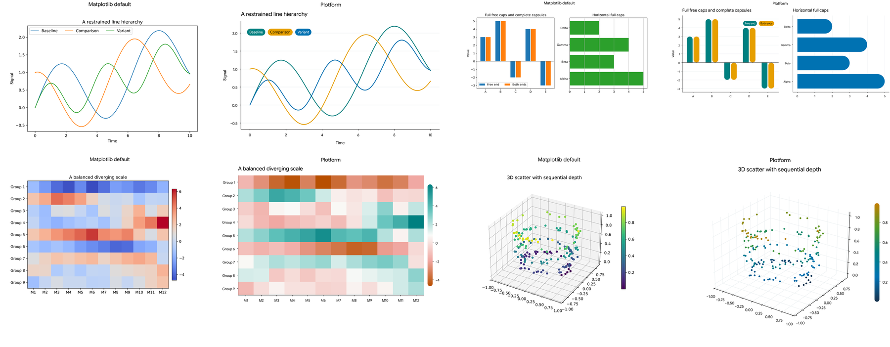
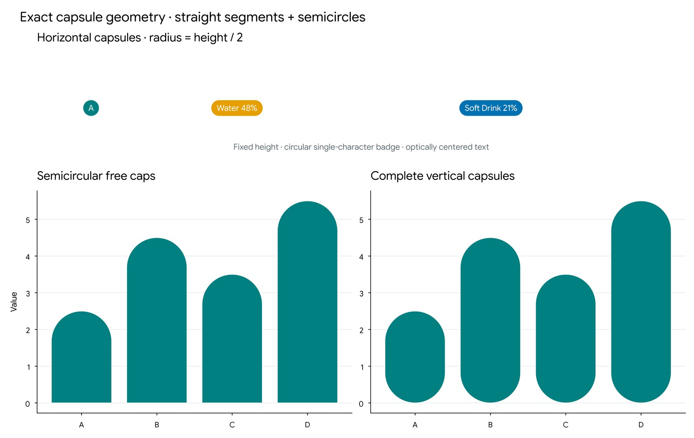

# Plotform

[](https://github.com/Econ01/plotform/actions/workflows/ci.yml)
[](https://pypi.org/project/plotform/)
[](https://pypi.org/project/plotform/)
[](LICENSE)

**A minimalist Matplotlib theme and plotting toolkit with customizable palettes, capsule-shaped chart elements, and bundled fonts.**

Plotform combines a vivid, minimalist visual style with native-style helpers for pill legends, circularly rounded bars, capsule annotations, vertical capsule colorbars, and clean 3D plots. Fonts are bundled, so system font installation is not required.

[](https://github.com/Econ01/plotform/tree/main/examples)

## Requirements

- Python 3.10 or newer
- Matplotlib 3.8 or newer
- NumPy 1.24 or newer

## Installation

```bash
python -m pip install plotform
```

For development from a source checkout:

```bash
python -m pip install -e ".[dev]"
```

## Quick start

```python
import matplotlib.pyplot as plt
import plotform as tm

tm.apply_theme()

fig, ax = plt.subplots()
ax.plot([1, 2, 3], [2, 4, 3], label="Example")
ax.set(title="A minimalist chart", xlabel="Time", ylabel="Signal")
tm.legend(ax)

fig.savefig("chart.png", dpi=800)
fig.savefig("chart.pdf")
```

`apply_theme()` resets Matplotlib's style before applying Plotform and changes process-global settings. Call it once before creating figures. To preserve and later restore another style, use the scoped form:

```python
with tm.theme():
    fig, ax = plt.subplots()
    ax.plot([1, 2, 3], [2, 4, 3], label="Example")
    tm.legend(ax)
    fig.savefig("chart.png")
# Previous rcParams are restored here.
```

## Plain Matplotlib, without Plotform

Scripts that must run without the package do not need a compatibility layer. Use native Matplotlib directly:

```python
import matplotlib.pyplot as plt

fig, ax = plt.subplots()
ax.bar([0, 1, 2], [3, 5, 4], label="Example")
ax.legend()
fig.savefig("plot.png")
```

`examples/native_matplotlib.py` is a complete instructor-friendly example. Plotform is an opt-in enhancement, not a requirement for these scripts.

## Native-style helpers

| Helper | Purpose |
| --- | --- |
| `tm.legend(ax)` | Solid or soft pill legends with adaptive text contrast |
| `tm.bar(x, height, ax=ax)` | Vertical bars with circular caps |
| `tm.barh(y, width, ax=ax)` | Horizontal bars with circular caps |
| `tm.colorbar(image, ax=ax)` | Vertical capsule colorbar with external ticks |
| `tm.annotate(text, xy, ax=ax)` | Exact capsule annotation |
| `tm.style_3d(ax)` | Minimal 3D panes, grids, ticks, and viewing angle |

`legend()` uses the current axes when `ax` is omitted. `colorbar()` uses the current figure and axes. Advanced geometry remains available through `plotform.rounded`; font utilities remain available through `plotform.fonts`.

## Fonts

- **Plotform Sans**, derived from Google Sans Flex with `ROND=100` and default weight 400.
- **Plotform Mono**, derived from Google Sans Code at its default weight.
- DejaVu fallbacks for mathematical notation and missing glyphs.

The package registers its bundled fonts directly with Matplotlib. No operating-system installation or cache clearing is needed. Font licenses and attribution are included under `src/plotform/assets/fonts/`.

## Colors

The default vivid categorical cycle is:

| Order | Color | Hex |
| --- | --- | --- |
| 1 | Teal | `#008080` |
| 2 | Amber | `#E69F00` |
| 3 | Blue | `#0072B2` |
| 4 | Coral/vermillion | `#D55E00` |
| 5 | Purple | `#6A51A3` |
| 6 | Green | `#4C9A2A` |
| 7 | Rose | `#CC79A7` |
| 8 | Dark slate | `#4B5563` |

Extend the cycle deterministically:

```python
tm.apply_theme(n_colors=14)
colors = tm.get_palette(14)
```

Axes, labels, and ticks are black by default while grids remain light. For muted-gray decorations:

```python
tm.apply_theme(gray_decorations=True)
```

Three continuous colormaps are registered:

```python
ax.imshow(values, cmap=tm.SCALAR_CMAP)  # Full-range scalar default
ax.imshow(values, cmap=tm.DIVERGING_CMAP)  # Signed/diverging data
ax.imshow(values, cmap=tm.SEQUENTIAL_CMAP)  # Optional pale brand-teal map
```

`SCALAR_CMAP` follows navy → blue → teal → green → amber, avoiding near-white endpoints. Use fully opaque scalar markers and `depthshade=False` for mplot3d scatter plots. Use `shade=True` for `bar3d` to preserve face lighting.

## Pill legends

Solid category-color fills use adaptive white or black text, targeting at least 4.5:1 contrast. Marker and line handles are explicitly hidden so they cannot overlap labels.

```python
tm.legend(ax, ncols=3)
```

For auxiliary uncertainty regions, use an explicitly tinted entry:

```python
tm.legend(ax, styles={"95% interval": "soft"})
```

For dense plots, place the legend outside or add a white group capsule:

```python
tm.legend(ax, outside=True)
tm.legend(ax, backdrop=True, backdrop_alpha=0.88)
```

## Rounded bars and annotations

```python
import numpy as np

x = np.arange(4)

# Exact semicircular cap with a square baseline.
tm.bar(x, [3, 5, -2, 4], radius="full", ends="free", ax=ax)

# Complete vertical capsule.
tm.bar(x, [3, 5, -2, 4], radius="full", ends="both", ax=ax)

# Clamp bars too short for an exact full capsule.
tm.bar(x, [3, 5, -2, 4], radius="fit", ends="both", ax=ax)

# Numeric circular corner radius.
tm.bar(x, [3, 5, -2, 4], radius=0.16, ax=ax)
```

Exact full mode raises a clear error when the display geometry cannot contain the requested semicircle. Use `radius="fit"` to opt into clamping instead.

Annotations use exact stadium geometry:

```python
tm.annotate("New", (0.15, 0.85), ax=ax, transform=ax.transAxes)
```

`plotform.rounded` also exposes `capsule_path`, `CapsuleBox`, and separate squircle primitives for advanced use.

[](https://github.com/Econ01/plotform/blob/main/examples/geometry_check.py)

## Capsule colorbars

```python
image = ax.imshow(values, cmap=tm.SCALAR_CMAP)
colorbar = tm.colorbar(image, ax=ax)
```

The visible gradient is clipped to an exact vertical capsule in display space. Ticks and labels remain outside. Image, contour, streamplot, scatter, and surface mappables are supported. Standard rectangular `fig.colorbar()` output remains available.

## 3D plots

```python
fig = plt.figure()
ax = fig.add_subplot(projection="3d")
tm.style_3d(ax)
ax.plot_surface(xx, yy, zz, cmap=tm.DIVERGING_CMAP, shade=True)
```

`style_3d()` clears panes and applies consistent grids, ticks, and viewing geometry. Pass `gray_decorations=True` for muted decorations.

## Visual showcase

```bash
python examples/showcase.py
python examples/geometry_check.py
```

The showcase creates 27 default-versus-Plotform comparisons at 800 DPI, lightweight previews, selected PDF/SVG exports, and a contact sheet under `artifacts/showcase/`. The geometry script creates exact capsule reference boards under `artifacts/`.

[View the complete 27-chart contact sheet](https://github.com/Econ01/plotform/blob/main/docs/images/contact-sheet.png) or regenerate the documentation images with `python tools/make_doc_images.py`.

## Development

```bash
python -m pip install -e ".[dev]"
pytest
ruff check .
ruff format --check .
python -m build
```

See `CHANGELOG.md` for release history and `docs/RELEASING.md` for the GitHub, TestPyPI, and PyPI release process.

## License

Code is MIT licensed. Bundled font software remains under the SIL Open Font License; see the font asset notices for details.
